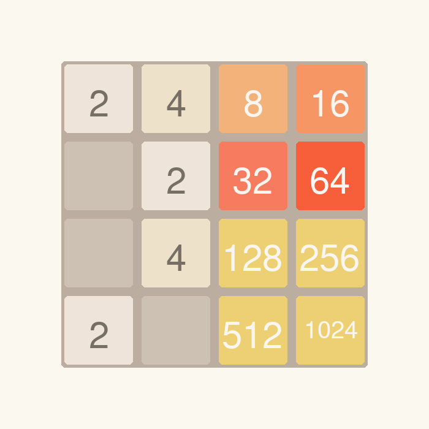
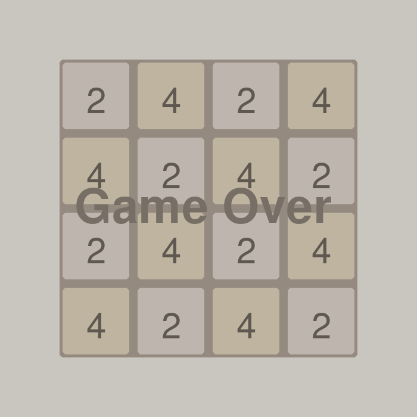

# 2048

A desktop clone of the 2048 puzzle game written in Python with Pygame. Slide the tiles on a 4x4 board, merge equal numbers, and keep going until no moves are left.

## Features

- Classic 4x4 board with keyboard control (arrow keys or WASD).
- Equal tiles merge when they collide, and new tiles appear after every move that changes the board.
- Color-coded tiles, using the familiar 2048 palette.
- Game over detection: when no move is possible, the board dims and a "Game Over" message appears.
- Restart and quit from the keyboard.
- Optional Linux desktop launcher with an icon.

## Screenshots

| Mid-game | Game over |
|:---:|:---:|
|  |  |

## Controls

| Action | Keys |
|---|---|
| Move left | Left arrow or A |
| Move right | Right arrow or D |
| Move up | Up arrow or W |
| Move down | Down arrow or S |
| Restart | Ctrl + R |
| Quit | Ctrl + Q, or close the window |

## Tech Stack

| Area | Technology |
|---|---|
| Language | Python 3 (tested on 3.12) |
| Graphics and input | Pygame (tested on 2.6.1) |
| Standard library | `random`, `copy` |

There are no other dependencies.

## Project Structure

```
2048game/
├── 2048.py          The whole game: board logic, rendering, and main loop
├── 2048.desktop     Linux desktop launcher
├── icon/
│   ├── 2048_logo.png    Icon used by the launcher
│   ├── 2048-game.png    Alternative icon (1024x1024)
│   └── icon.png         Alternative icon (board preview)
└── screenshots/     Screenshots for this README
```

## How It Works

All code lives in `2048.py`:

- **`Plyta`** represents a single tile. It stores the value and picks the tile color and text color from it.
- **`Left`, `Right`, `Up`, `Down`** implement a move in each direction. A move first slides all tiles to the edge, then merges equal neighbors, and slides again to close the gaps.
- **`rad()`** runs after a move that changed the board. It adds new tiles, then tries all four moves on a copy of the board. If none of them changes anything, the game is over.
- **`clear()` and `draw_plyt()`** draw the background and the tiles on an off-screen surface, which is then shown in the 700x700 window.
- **`restrart()`** resets the board and the game state.
- The main loop at the bottom of the file handles keyboard events and redraws the window.

## Getting Started

You need Python 3 and Pygame.

```bash
git clone https://github.com/ArseniZar/2048game.git
cd 2048game

python3 -m venv venv
source venv/bin/activate        # Windows: venv\Scripts\activate

pip install pygame

python3 2048.py                 # Windows: python 2048.py
```

### Linux desktop launcher (optional)

`2048.desktop` contains absolute paths from the author's machine, so edit these two lines to point to your copy of the project:

```
Exec=python3 /path/to/2048game/2048.py
Icon=/path/to/2048game/icon/2048_logo.png
```

If you installed Pygame in a virtual environment, use that interpreter in `Exec`, for example `/path/to/2048game/venv/bin/python`. Then copy the file to your applications folder:

```bash
cp 2048.desktop ~/.local/share/applications/
```

## Known Limitations

- There is no score counter and no best score.
- Reaching 2048 does not show a win message, the game simply continues.
- Tiles with values above 128 share the same color.
- The window can be resized, but the board is not scaled.
